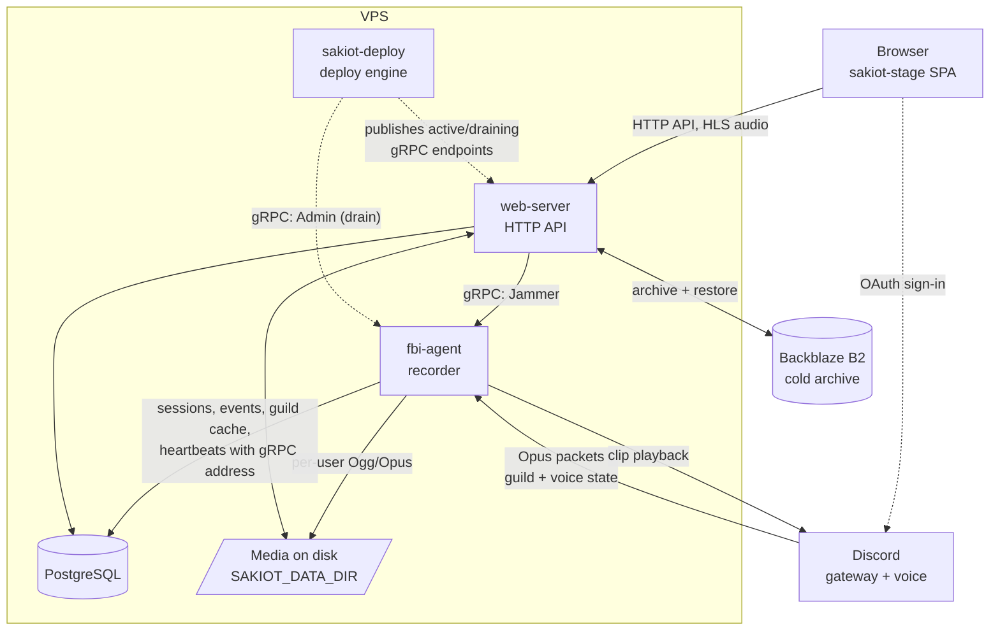

# Architecture

How the pieces fit together and how audio travels from a Discord voice
channel to a clip in a browser. Component setup and operational procedure live
in the component READMEs and [`ops/README.md`](../ops/README.md); this document
is the map that sits above them.

## Components

| Component | Kind | Responsibility |
| --- | --- | --- |
| `fbi-agent` | Rust service | Discord gateway client and voice recorder. The only component that talks to Discord. |
| `web-server` | Rust service | HTTP API, authentication, media rendering and serving, gRPC client to the agent. |
| `sakiot-stage` | React SPA | The user interface. Talks only to `web-server`'s HTTP API. |
| `sakiot-db` | Migrations | Sole owner of the PostgreSQL schema. Neither service migrates at startup. |
| `sakiot-paths` | Rust crate | The filesystem and URL layout, shared so both services agree on where media lives. |
| `sakiot-permissions` | Rust crate | The permission evaluator: guild facts in, capabilities out, with no I/O. Used by `web-server` and `fbi-agent`. |
| `sakiot-proto` | Rust crate | The gRPC contract (`fbi_agent.proto`) and its generated types. |
| `sakiot-storage` | Rust crate | Backblaze B2 archive configuration and S3 client. |
| `sakiot-dsp` | Rust crate → native + WASM | Audio effects, compiled both into `web-server` and to WASM for the browser. |
| `ops/sakiot-dev` | Rust CLI | Local development orchestration (`cargo dev`). |
| `ops/sakiot-deploy` | Rust CLI | The deployment engine that runs on the VPS. |

## System shape

Both services run on the same host and share one PostgreSQL database and one
media directory. That shared state, not a message bus, is the primary
integration point — which is why `sakiot-paths` and `sakiot-db` exist as
single owners of the layout and the schema.

## Recording path

1. **Capture.** `fbi-agent` joins a voice channel and Songbird emits a voice
   tick every 20 ms carrying the RTP packets received in that window.
   `voice_receiver/actor/packets.rs` extracts the raw Opus payload from each
   packet, skipping any RTP header extension.
2. **Write.** `events/ogg_opus_writer.rs` writes that payload through
   unmodified, so there is no decode/re-encode cycle in the recording path. It
   batches packets into Ogg pages of about 500 ms (25 packets, within RFC 7845's
   recommended range) behind a buffered file writer. A growing file is readable
   up to its last complete page; a crash loses at most the page in progress and
   the writer's unflushed buffer. One writer per user. On ticks where a tracked
   user produced no packet it writes a pre-encoded 20 ms silent frame instead,
   so each file's timeline matches wallclock and the per-user files stay
   mutually aligned. Discord's frames are stereo 48 kHz at 960 samples. A writer
   whose write fails is closed at once as a writer error.
3. **Track.** The recorder actor (`events/voice_receiver/`) owns the writers and
   the session lifecycle: joins, moves, pauses, policy suspensions, recovery.
   Session and event rows go to PostgreSQL as they happen. Each actor
   heartbeats one `recorder_heartbeats` row every 10 s, and every file it
   creates carries that row's id. A recording is live while it is unfinished
   and both its actor and its bot instance heartbeat; every liveness check
   reads the `live_audio_files` view. A crashed actor's row goes stale, and a
   restarted process gets new actor ids, so its predecessor's files stop
   counting as live within 120 s and the next startup reaps them. A file whose
   finalize fails is retried on every heartbeat, so it keeps its real length.
4. **Group.** A *logical recording session* groups the per-user files that
   belong to one sitting in one channel. This is the unit the UI presents and
   the unit deletion and archival operate on.

Files land under `SAKIOT_DATA_DIR` at paths computed by `sakiot-paths`, keyed by
guild, channel, year, month and session timestamp. `web-server` recomputes the
same paths from the same crate rather than reading them from the database.

## Playback path

`web-server` serves audio three ways, all as HLS:

- **Per-user recordings** — one speaker's Ogg/Opus, optionally with silence
  stripped (`audio/silence.rs`).
- **Mixed sessions** — every participant mixed into one timeline
  (`audio/sessions/mix/`), rendered on demand and cached. `occupancy.rs`
  reconstructs who the bot had in the channel across the timeline, so the mix
  and the UI agree on which participants exist when. Each viewer's mix holds
  only the tracks they may hear (their own voice, and anyone else's recorded
  in a channel they may listen in, unless that speaker keeps their
  recordings private); the rest are left out, and such a mix is
  cached apart, keyed by the recordings it leaves out. Removed sessions never
  contribute.
- **Live** — a recording still in progress, muxed to HLS while it grows
  (`audio/live.rs`).

Waveforms are drawn from peaks files (`sakiot-peaks`), so the client draws a
waveform without downloading the audio and the server serves one without
decoding it. A peaks file holds the lowest and highest sample of every 20 ms
frame. The recorder writes one beside each recording as it records, from the
audio songbird has already decoded, in step with the Ogg file. So a live
recording's waveform is current on every request, and the dashboard refreshes it
while it records. A session's waveform is stitched from its recordings' peaks
along the session timeline. The client places peaks by time, so a live waveform
stops where its audio stops and the rest of the timeline stays blank.

Audio without peaks is decoded in-process by a media job: silence-free renders,
clips, and ended recordings whose peaks failed, were evicted, or predate the
recorder writing them. A live recording is never decoded, because the snapshot
would stop short of the audio. Peaks files are local cache in `waveform_data/`,
never archived. They go when 30 days pass without a write, or when the archive's
cache cap removes them, and are then decoded again from the audio. The cap spares a
peaks file written in the last hour, as it spares a live HLS directory.

## Clip editing and the DSP parity story

The clip editor is the one place where the same audio code runs in two
environments. `sakiot-dsp` is compiled twice:

- **Natively**, as a path dependency of `web-server`, to render the final clip.
- **To WASM**, loaded by the frontend into an `AudioWorklet`
  (`features/clip-editor/sharedDspAudioWorklet.ts`) for live preview.

Both sides run the same `SegmentProcessor`, so what the user previews is what
gets rendered. Every stored recording and clip is 48 kHz Opus, and the editor
decodes and plays at 48 kHz whatever the output device's rate, the rate the
renderer uses; the browser converts only the final mix for the device.

User uploads do not exist yet. If they are added, convert each upload once on
arrival to 48 kHz stereo Opus and store only that file, so everything
downstream sees what recordings already provide. The preview and the export
each convert audio on their own, and for other formats they would not quite
agree:

- The browser and ffmpeg resample with different converters.
- The editor reads only the first two channels
  (`features/clip-editor/sharedDsp.ts`), which drops the center of a 5.1 file.
  The export's `-ac 2` downmix mixes it in.
- MP3 and AAC encoder delay can be trimmed differently, moving trims by tens of
  milliseconds.
- Clip cutting copies the Opus stream without re-encoding
  (`web-server/src/clips.rs`).

Every clip access check goes through a channel, so an upload should belong to
a channel the uploader can access and follow that channel's permissions. The crate core deliberately has no browser
or server dependencies; the `wasm` feature only adds a thin `wasm-bindgen`
boundary.

`sakiot-dsp` is a member of the root Cargo workspace, so the workspace build,
tests, and Clippy cover its native side. A dedicated CI job additionally lints
the `wasm` feature, builds the WASM artifact, and verifies it against native.

## Service-to-service calls

`fbi-agent` serves two gRPC services, defined in
`sakiot-proto/proto/fbi_agent.proto`:

- **`Jammer.JamIt`**, called by `web-server` — play a stored clip back into a
  voice channel. The agent answers with an outcome (queued, not in voice, on
  cooldown, failed) that `web-server` maps onto the error contract below. The
  user's cooldown is spent only once the clip is ready to play.
- **`Admin`**, called by the deploy engine — drain, cancel drain, status,
  shutdown-when-empty, force shutdown. These support zero-downtime deploys: a
  new agent starts, the old one drains until its voice connections are empty,
  then exits ([`fbi-agent`](../fbi-agent/README.md#releases-and-draining)).

Every call presents the environment's `FBI_AGENT_REGISTRY_SECRET` in the
`x-fbi-agent-registry-secret` metadata (`sakiot_proto::INTERNAL_SECRET_HEADER`),
which the agent checks in constant time before either service runs
(`fbi-agent/src/grpc/auth.rs`). All environments bind their agents to the same
host's loopback, so reaching the port proves nothing. A release build of the
agent refuses to start without the secret; a debug build runs open for local
development.

`web-server` picks the agent to call per guild from PostgreSQL
(`agent_address_for_guild` in `web-server/src/fbi_agent_registry.rs`). Every
agent heartbeats its gRPC address into `bot_instances`, and
`voice_session_leases` records which instance holds each guild's voice
connection, so during a handover a clip still goes to the draining instance
that is in the channel. The deploy engine also publishes the active and
draining endpoints to an in-memory registry on `web-server`
(`/internal/fbi-agent/grpc-endpoints`, outside `/api`). That registry is only
the fallback when no live heartbeat resolves, and until the first publish it
holds the configured `GRPC_ADDRESS`. When `FBI_AGENT_REGISTRY_SECRET` is set,
the endpoint requires it in the same header, compared in constant time, even
from loopback. Without it, which only local development does, it accepts
loopback callers.

## Authentication and authorization

Users sign in through Discord OAuth. `web-server` issues a JWT in a cookie
(`auth/jwt.rs`, `auth/cookies.rs`) and validates it in middleware. In local
development `/api/dev_login` trades a secret from `.env` for the same cookie,
so Discord is not needed to work on the app; that secret never reaches the
bundle. Each login mints one CSRF token for state-changing requests, and it
stays fixed for that login: `/api/refresh` renews the access and refresh
tokens but keeps it, so tabs refreshing at the same moment cannot invalidate
each other.

Each login is also a row in `auth_sessions` (`auth/sessions.rs`), and both
tokens carry its id. The 15-minute access token is checked only by signature,
but `/api/refresh` succeeds only while the row exists, and each refresh issues
a new 7-day refresh token, so a session lasts as long as it keeps being used.
Logout deletes the browser's own row, and "Log out everywhere"
(`DELETE /api/users/current/sessions`) deletes every row of that identity (a
dev login and a Discord login with the same id are different identities).
Other browsers stop within 15 minutes, when their access token expires, which
also closes their realtime socket. The account menu's "Signed-in devices"
lists the sessions (`GET /api/users/current/sessions`) and logs one out
(`DELETE .../sessions/{id}`). Each row names its browser and platform, parsed
from the User-Agent at sign-in (`auth/device.rs`); the User-Agent string itself
and IP addresses are never stored.

Authorization reimplements Discord's permission model against the agent's role
cache, so role and membership revocations take effect without a new login. The
rules live in `sakiot-permissions`, a pure evaluator: plain facts about a guild
go in, and what a viewer may do comes out as Sakiot capabilities (listening,
presence, management and so on), each defaulting to the Discord permissions
it always meant. The agent writes the cache one guild per transaction and only
where it differs from Discord (`fbi-agent/src/database/guild_cache.rs`), so a
request never sees a guild's role assignments or overwrites half rewritten. It
removes member role assignments only when its cached member list is complete.
On the read side, a request loads the viewer's access once
(`GuildAccess`, `web-server/src/permissions/`) and asks it everything. It
takes one statement (`permissions/facts.rs`), which sees one consistent
snapshot, so a cache write committing mid-check cannot mix old and new state.
The agent asks the same evaluator for `/jam`, its autocomplete and `/stamp`,
with facts built from its gateway cache (`fbi-agent/src/permissions.rs`),
where the cached member list is the roster, and the guild's rules read from
the database per command; a test checks its Discord answers against
serenity's own permission rules on random guilds.
Each guild-wide action needs its own capability: `manage_settings` for
cooldowns, recording policy and voice settings; `manage_permissions` for the
rule editor; `preview_roles` for role preview and the roles page;
`delete_recordings`; and `moderate_clips` for someone else's clip. Per voice
channel: `view_presence`, `listen_others`, `create_clips`, `jam` (playing a
clip where the bot is, from `/jam` or the dashboard) and `stamp`.

Sakiot's own rules (`permission_rules`, `sakiot_permissions::Rules`) sit on
top of Discord's. A rule allows or denies capabilities to `@everyone`, a role
or a user, guild-wide or in one voice or stage channel, and they apply after
Discord in Discord's own order, the most specific last: guild-wide
`@everyone`, the holder's roles together (an allow beats a deny), the user;
then the same in the channel. A guild-wide rule's content capabilities reach
every channel; management capabilities exist only guild-wide. So a rule can
grant what Discord denies, and deny even an `ADMINISTRATOR`. Guards no rule
breaks: the owner keeps every management capability; rules never reach a
former member or an outsider; and no rule widens listening past a member's
consent. Holders of `manage_permissions` edit them
(`web-server/src/admin/permission_rules.rs`, `GuildFacts::edit_rule`): they
see the channels they can see (the owner every one), change only what they
hold where the rule applies (guild-wide content takes holding it in every
channel), and never take `manage_permissions` from themselves. Edits run one
at a time per guild. A rule whose role or channel is gone reaches nobody and
anyone may delete it. The explainer (`.../permission-rules/explain`) shows,
for a member or a role, each capability and the layer that decided it
(`GuildFacts::explain`).
Membership comes from the agent's roster, not from the guild list Discord
returned at login (`GuildFacts::membership`):

- A Discord login owns a guild only per `guilds.owner_id`, and belongs to it
  only when listed on its complete roster (`guild_members` with
  `guild_projection_state.roster_complete_at` set). The last complete roster
  stays authoritative while the bot is stopped.
- Someone who does not belong but has recordings of their own in the guild
  is a former member: they list and play the recordings, clips and stamps of
  their own voice there, and reach nothing else. Once the bot has left a
  guild (no `guilds_present` row; an outage does not count), nobody belongs,
  owner included, since its cached roles and overwrites stop updating:
  everyone with recordings there is a former member. `guilds.bot_left_at`
  records when it left; its return clears it and everyone is back. The guild
  picker lists a former member's guilds too, marked `former`, and the
  dashboard shows them only their recordings, clips and stamps.
- Their own sessions the server removed (a manager's deletion, or
  retention) stay listed to their speaker alone, as removed: unplayable,
  and theirs only to erase (`File.removal` in the recording tree).
- While the bot is in a guild whose roster is not complete yet, nobody but
  the owner can be answered: requests fail with a retryable 503
  `membership_unavailable` (Retry-After 5) rather than a guess, and the
  dashboard repeats reads for about half a minute
  (`sakiot-stage/src/app/membershipRetry.ts`). The guild picker
  (`/api/users/current/guilds`) lists such a guild only once its roster is
  complete, with the bot's live name and icon and the viewer's guild-wide
  capabilities, which decide the admin pages the dashboard shows.
- A dev login (local, staging and preview builds) keeps the seeded
  `user_guilds` rows, including their owner flag, since staging's bot is in a
  different server. Its guild picker lists the guilds it is seeded in, under
  their seeded names. Every check, realtime socket and background job carries
  the login kind (`Viewer`; `requester_dev` on media and composition jobs).

Discord sign-in asks only for the `identify` scope, so the app never learns
which other servers someone is in. `user_guilds` holds only the dev seeds
(`scripts/dev-seed.sql`, `cargo dev` fixtures); nothing else writes it.
`ops/sql/membership-parity.sql` lists who a deploy of this rule would cut
off. Channel visibility applies `@everyone`, role and member overwrites in
Discord's order. A member can list and play anyone else's recording only when
they have VIEW_CHANNEL and CONNECT in every channel it touched; a recording of
their own voice alone is always theirs, wherever it was made
(`Access::allows_item`). That covers their sessions and recordings, clips of
only their voice, and stamps on it, in listings, playback, live updates and
`/jam`. Making something new of it is not: clipping or composing takes
`create_clips` in every channel the new clip's audio comes from, and a role
preview never shows anyone's own recordings. A clip needs only the
channels its own audio came from (`clips.channel_ids`, recorded when the clip
is made): a clip cut from the part of a session recorded in one channel needs
that channel alone, a clip of a session's silence-free copy every channel of
the session, and a composed clip every channel of its sources. The web server
and the bot's `/jam` apply the same rule. Each clip also records whose voices
it holds (`clips.speaker_ids`: a session's or recording's speaker, or every
source's speakers for a composed clip; empty when not known). Visibility covers the
channels the agent records: voice (type 2) and stage (type 13). Stage channels
need a Community server, so they are verified by fixture tests only.

Each member also decides who may hear their voice, per server (listening
consent, `recording_private`): shared by default, meaning whoever the
channels admit, or private, meaning only themselves. No capability outweighs
it, the owner's included. It is checked when read, never copied onto items,
so it covers earlier sessions, mix tracks, clips holding their voice (with
anyone else's), stamps on it, live recordings and `/jam` at once. The facts
statement loads the guild's private members, and `Access::allows_item` asks
it. A clip whose speakers are unknown cannot ask, and follows its channels
alone. A holder of `delete_recordings` sees a private session they could
otherwise hear as a redacted tree entry (`File.redacted`: who, where and
when; no audio, waveform, live stream, mix track or stamps) so they can
still remove it (`Access::redacts_item`). Members change it with
`/recording private` and `/recording shared`, or in the account menu
(`/api/users/current/guilds/{guild_id}/recording-privacy`); former members
can too.

Managers with `preview_roles` (by default Administrator or MANAGE_GUILD) can
preview a guild as one of its roles (`as_role` on the session tree, live
stems, clips and stamps, and the role view under `/api/admin`). A preview
never shows more than the manager's own view: `RolePreview` keeps only the
channels the manager can view and join, and a session touching any other
channel is dropped rather than shown as hidden, and so is a session whose
speaker keeps it private: a preview never redacts. Only Administrator bypasses channel overwrites in
Discord, so this matters for MANAGE_GUILD-only managers; owners and
Administrators see unclipped previews.

## Realtime updates

Dashboards learn about changes from a WebSocket instead of polling. The path
is: committed write → PostgreSQL trigger → `NOTIFY sakiot_realtime` → one
listener per `web-server` process → authorized fan-out → the client refetches
over HTTP. Events are refresh signals that carry identifiers only; data always
comes from the existing authorized endpoints. Voice presence is the one
exception: clients that ask for it get each change as data (see Members and
voice presence).

- **Triggers** (`sakiot-db/migrations/20261003010000_realtime_notifications.sql`)
  cover recordings, clips, stamps, opt-outs, guild settings and the permission
  cache. They fire for whichever binary writes, including a draining bot.
  Update triggers compare displayed columns only, so no-op writes are
  silent. Permission tables send one guild-wide `perm` payload per
  transaction, and only for columns authorization reads; a renamed guild,
  role or voice channel sends `names` instead, and a role assignment
  `members` (`20261017010000_realtime_names.sql`). Media jobs, clip exports and recording deletions notify when
  their state, stage, progress or error changes, never on a lease renewal
  (`20261006000000_realtime_job_notifications.sql`).
- **Listener** (`web-server/src/realtime/listener.rs`) holds a dedicated
  connection and coalesces notifications for 100 ms. A lost connection or a
  notification gap re-authorizes every subscription and sends
  `resync_required`. A self-NOTIFY measures the round trip, and
  `pg_notification_queue_usage` is exported: a full queue fails every
  notifying commit.
- **Authorization** (`web-server/src/realtime/hub.rs`) is cached per
  subscription (viewer, guild, optional role preview) as `SubscriptionAccess`
  (`realtime/hub/access.rs`) and recomputed on every permission event before
  other events in the batch are routed. One statement loads the facts of
  every affected guild for all their subscribers; each scope is evaluated in
  memory, and only a viewer whose access changed gets `access_changed`. A
  member joining or a role changing hands sends nothing to anyone else.
  Ids go only to viewers the HTTP listing would show the item to; a clip
  payload carries the clip's channels for that, and a change of channels
  (an overwritten composition) is sent with the old ones too. A viewer
  who may have seen a session before a change hid it gets an
  identifier-free `changed` instead. Opt-outs and listening consent reach
  only their owner; a consent change is also a permission event, since it
  changes what everyone else hears, and the speaker's sessions, clips and
  stamps then reach only them (and a session id the managers who redact
  it);
  settings reach holders of `manage_settings`, permission rules holders of
  `manage_permissions` (a rule change is also a permission event), keeping
  (caps, allowances and keeps) every member, the
  roster and roles holders of `preview_roles`, `manage_settings` or
  `manage_permissions`, and role previews follow the
  role-preview rule above. Renames refresh where the name shows: the guild
  list (`guilds`), the members pages, and for a channel the presence and
  stamps of viewers who see it and the recording policy. Job ids reach only
  whoever may read the job's status: a media job's viewers
  (`media_job_viewers`), an export's owner, holders of
  `delete_recordings` for a deletion by the server, and the speaker for
  their erasure. A removed session's events and an erasure's
  (`20261018030000_speaker_erasure.sql`) give its speaker the id, and
  everyone else an identifier-free refresh. A refused scope (not a member yet, or a
  roster still loading) stays pending: the next permission event that grants
  it sends `subscribed`, then `access_changed` for the guild list.
- **Socket** (`GET /api/realtime`, `web-server/src/realtime/socket.rs`)
  accepts only the exact origins in `CORS_ALLOWED_ORIGIN` and
  `OAUTH_ALLOWED_OPENER_ORIGINS`, with no subdomain wildcard. It sends a
  `heartbeat` every 20 s and closes after 60 s of silence, closes with 4001
  when the access token expires and with 4400 for an unsupported protocol
  version, and replaces a backlog of more than 256 messages with one
  `resync_required`. The message types are in the OpenAPI document, so the
  frontend's generated types cover them.
- **Shutdown**: on SIGTERM the server closes every socket with 1012 at once,
  then gives in-flight HTTP requests 5 s, so open sockets never hold up a
  restart.
- **Hosting**: every environment needs nginx to forward WebSocket upgrades
  on `/api/realtime` and the CSP to allow the socket; see
  [`ops/README.md`](../ops/README.md). Where the socket keeps failing,
  clients keep polling.
- **Targeted refresh**: `GET /api/current/{guild}/sessions/{session}` returns
  one session's tree entry, or null when it is missing, deleted or not visible,
  so a `changed` event refreshes one session instead of the whole tree.
- **Client** (`sakiot-stage/src/realtime/`): one coordinator per tab owns the
  socket, follows the route's guild and role preview, and turns events into
  RTK Query updates (a targeted session patch, or tag invalidation). It renews
  the access token before expiry on a replacement socket. After repeated
  failures it falls back to polling the tree, live stems, clips and stamps
  every 30 s. Manifests (every 5 s until finalized) and a file's live state
  (every 10 s) poll even while realtime is live: a growing recording writes
  no row at all (only its actor's heartbeat), so no event announces new
  audio. A query still waiting on a job carries its `Job` tag (by job id), so
  a `jobs` event refetches exactly that query; while realtime is live such
  pages poll every 5 s instead of every second, which only covers an event
  that arrived before the page knew the job's id. Silence removal and download
  preparation still poll every second. Settings forms
  keep an admin's draft when a refresh changes the saved value
  (`shared/useDraftField.ts`).

### Members and voice presence

The agent keeps two projections of its gateway cache: `guild_members`, the
current roster, and `voice_presence`, who is in which voice or stage channel
(`sakiot-db/migrations/20261004000000_member_presence_projections.sql`,
`fbi-agent/src/projections.rs`). The roster decides membership (see
Authorization); joining, leaving and a roster becoming complete send `perm`,
so open sockets are re-authorized.

- **Ownership**: one instance writes a guild's projections, recorded in
  `guild_projection_state` with a generation. Every write locks that row and
  checks owner and generation, then writes what serenity's cache holds now,
  so writes are order-insensitive and a superseded writer is fenced out. A
  replacement claims a guild only from a complete snapshot, by bumping the
  generation; until then the incumbent keeps writing, even while draining.
  A draining instance never claims. A stopping instance releases what it
  still owns, which makes presence unknown rather than frozen.
- **Completeness**: Discord sends every member in GUILD_CREATE only below
  `large_threshold` (250). Above it the agent requests member chunks, one
  guild at a time with a 1 s gap, and claims the guild once the full chunk
  set arrives (`ChunkSet`). A guild whose request times out is retried at the
  next 15-minute refresh. Absence from an incomplete roster is never a
  departure: members are removed only by a member-remove event or a complete
  snapshot.
- **Presence** (`GET /api/current/{guild}/voice-presence`, `web-server/src/presence.rs`):
  every member sees who is in the voice and stage channels they can view.
  VIEW_CHANNEL is enough, as in Discord's channel list. Role previews follow
  the role-preview rule, clipped to the manager's own presence view. The
  response says `available: false` while no running agent owns the guild (a
  first rollout, a stopped or crashed owner), so clients show "unknown"
  instead of empty channels.
- **Events**: a `presence` payload names the member and the channel they
  were in (`20261007000000_realtime_presence_updates.sql`). The hub reads
  where each changed member is now, once per batch
  (`presence::seats`), and routes the change by each subscription's presence
  channels, computed as the endpoint does. A client that sets
  `presence_updates` in `set_scope` gets a `presence` message with the
  member's channel and state, or with no channel when they left the channels
  it can view; it patches its list instead of refetching it. So a move into a
  hidden channel looks like leaving, and a viewer who can see neither side
  hears nothing. Other clients get `changed` `presence` only for changes they
  can see. A payload without a member (a rename of someone in voice, an
  ownership change), more than 64 changes to one guild in a batch, or a failed
  lookup makes everyone refetch. `members` payloads carry only the guild and
  go to managers only.
- **Members** (`GET /api/admin/guilds/{guild}/members`): manager-only search
  by name or the start of an id, at most 50 per page and offsets up to 1000.
  `@everyone`'s member count and list come from the roster; the count is
  null until a roster has been complete once.
- **Client**: the recordings sidebar shows an "In voice" panel. It applies
  `presence` updates (`sakiot-stage/src/realtime/patchPresence.ts`), polls
  every 10 s without realtime, and every 60 s with it, because a crashed
  agent sends no event. Per-user cooldown overrides have a member picker
  next to manual id entry.

## Recording controls

Recording is on by default. Two controls narrow it, and both are enforced in
one place, `create_fragment_in` (`fbi-agent/src/database/logical_recordings.rs`),
under the guild's advisory lock:

- **Channel exclusions**, set by guild managers in the recording policy.
- **Member opt-outs** (`recording_opt_outs`), set per server by members
  themselves with `/recording opt-out` or the web app's account menu.

The recorder re-checks both once per second, closes writers as soon as either
applies, and suspends recording when it cannot read them. Opting out keeps
earlier recordings. Who may hear them is a separate choice, listening
consent (see "Authentication and authorization").

## Media lifecycle

Recordings age out of local disk into Backblaze B2:

- `media_archive/worker.rs` uploads eligible media and records it in
  `media_objects`; `spawn_local_cleanup` reclaims local copies afterwards.
- `media_archive/serve.rs` decides per request whether to serve locally or
  restore from B2 first (`RemoteDisposition`).
- Deletion is a job (`recording_deletion.rs`, `recording_deletion_jobs`),
  soft by default, so an accidental delete is recoverable. A soft job
  records the clips it hid (`hidden_clip_ids`). A holder of
  `delete_recordings` restores a removal within the retention period
  (`recording_deletion/restore.rs`): the session and those clips come back,
  unless something else still hides a clip, the job is deleted and
  `recording_restorations` keeps its audit. A removal its speaker is erasing
  stays removed.
- Members keep recordings past retention (`keeping.rs`, `kept_recordings`).
  The bot's operators (`operators`, managed on the server with
  `web-server operators list|add|remove`) cap how many distinct recordings
  each guild keeps (`guild_limits`, 0 by default) on their own dashboard
  (`/operator`). Within the cap, holders of `manage_settings` set allowances
  (`keep_allowances`): a member's own wins, else the largest of their
  roles', else @everyone's, else only the cap. For now a member keeps a
  recording retention removed, if they may hear it, which restores it for
  everyone; managers keep their own removals too, including redacted ones,
  and keeping is the only way back for anything past the retention period.
  Retention never removes a kept recording; any other removal (a
  manager's, or its speaker's erasure) frees its keeps, so every kept
  recording is visible. Lowering a cap leaves existing keeps alone and
  blocks new ones until the guild is under it.
- A speaker may erase a finalized session of their own voice, or a clip
  holding it (`recording_deletion/erasure.rs`, `recording_erasures`). The
  request hides it, and the clips made from it, from everyone else at once,
  and records exactly what it hid; for 30 days the speaker can still play
  it, unless the server had removed it first, and undo reverts what the
  request hid and nothing else. A removal by the server keeps its own job,
  so undoing returns the session to removed, never to a restored
  recording. Then the deletion worker's sweep converts the erasure into a
  permanent job (reason `speaker`), upgrading an existing soft job in
  place; a clip's job purges the clip and every clip composed from it.
  Permanent purging runs only with
  `SAKIOT_RECORDING_PERMANENT_DELETE_ENABLED`.

The archive is disabled by default locally. An enabled deployment requires
every `SAKIOT_MEDIA_S3_*` value and fails startup on partial configuration
rather than silently running without an archive. See
[`ops/B2_MEDIA_ARCHIVE.md`](../ops/B2_MEDIA_ARCHIVE.md).

## Contracts that are enforced, not documented

Four cross-component contracts are checked mechanically, which is why they do
not drift:

- **HTTP API → frontend types.** `web-server` emits an OpenAPI document at
  compile time; `bun run generate:api-types` derives the TypeScript from it and
  `check:api-types` fails CI when the checked-in types are stale.
- **Errors → users.** Every API error body is `{ code, kind, message }`
  (`web-server/src/errors.rs`), plus `retry_after_seconds` on a rate-limited
  (429) response. Unknown `/api` paths answer the same way. The one deliberate
  exception is a 409 from channel-mix generation, which returns the mix status
  document so the page can keep showing the tracks it found. `kind` is a stable
  `ErrorKind` that reaches the frontend through the same generated types;
  `message` is always safe to show, while SQL, paths, subprocess output, and
  upstream bodies are only logged.
  Background jobs persist the kind in `error_kind` and derive their displayed
  text from it, so legacy free-form `error` text is never returned. Retry
  decisions are made on types, never on wording. The frontend normalizes every
  failure (contract bodies, older bodies without `kind`, network failures,
  malformed responses) through `sakiot-stage/src/app/apiError.ts`.
- **SQL → Rust.** Every fixed production statement in `web-server` and
  `fbi-agent` is a `query!`/`query_as!`/`query_scalar!` macro, which SQLx
  verifies against the real schema at compile time. The metadata is committed
  in `.sqlx`, refreshed by `scripts/sqlx-prepare.sh` against a disposable
  database, and the pre-commit hook re-checks it when migrations or
  SQLx-using files are staged. The deliberate runtime-checked exceptions are
  the `sakiot-dev` tooling that runs caller-supplied SQL against arbitrary
  databases, and test fixtures.
- **Version → release.** `[workspace.package] version` is the only release
  trigger. Bumping it and merging tags `v<version>`, which deploys to
  production. See [operations](../ops/README.md#release-flow).

Because the services share `sakiot-paths`, `sakiot-proto` and one schema, a
change that spans a contract is one atomic commit rather than a coordinated
rollout. That is the main reason this is a monorepo.

## Where things run

Pushes to `main` deploy to staging; a version bump promotes to production after
staging verifies; branch pushes can get a preview slot. Rollback is a workflow.
The deploy engine is `ops/sakiot-deploy`, a typed Rust CLI rather than a shell
script. Details in [operations](../ops/README.md).
